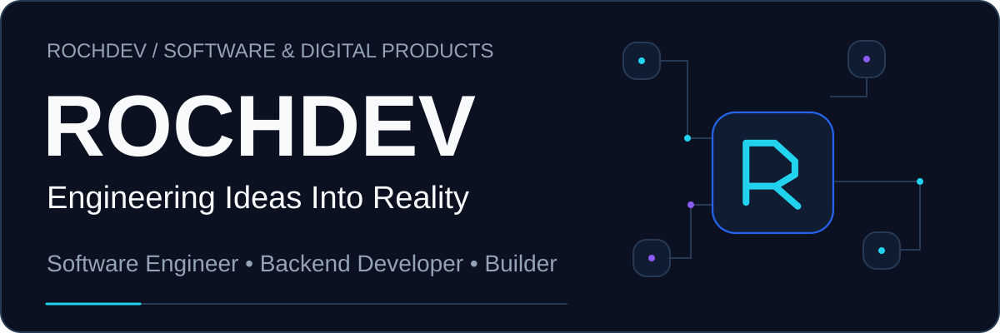
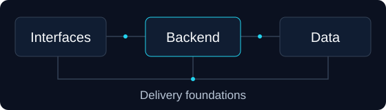
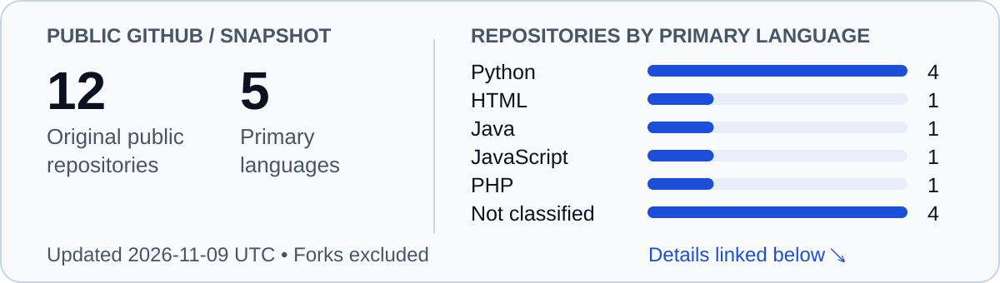

<picture>
  <source media="(max-width: 600px)" srcset="assets/branding/banner-mobile.svg">
  
</picture>

# Hi, I'm RochDev.

**Software Engineer · Backend & Full-Stack Developer**

Building reliable systems and meaningful digital products. Based in Cameroon 🇨🇲

[Selected work](#selected-work) · [Technical expertise](#technical-expertise) · [Let's build](#lets-build)

## About me

I'm **Rochinel Lontchi**, a developer drawn to the work behind the interface: how data moves, how business rules hold up, and how a system stays understandable as it grows.

My focus is backend engineering, with hands-on work across web and mobile development. I like taking a real operational problem and building the pieces that make a useful product. I'm growing toward software architecture and infrastructure, with an entrepreneurial interest in tools that help businesses in Cameroon and beyond.

**Software engineer. Builder. Problem solver. Aspiring tech entrepreneur.**

## Selected work

### 01 / Facteo

**A clearer workflow for business invoicing.**

A web application that brings sales and purchase invoices, customers and suppliers into one place. The public implementation includes server-side amount calculations, invoice numbering by type and year, and PDF, Excel and Word exports.

`Python` `Django REST Framework` `React` `TypeScript` `Tailwind CSS`

[Explore the code](https://github.com/Rochinel-codeur/Facteo) · [Architecture notes](https://github.com/Rochinel-codeur/Facteo/blob/main/docs/ARCHITECTURE.md)

### 02 / QuizLy

**Exploring AI as a learning companion.**

An experimental science quiz application that generates questions and explains answers. A graph-based workflow connects generation, evaluation and feedback: a practical space for learning how to integrate AI into a product.

`Python` `FastAPI` `LangGraph` `LangChain` `JavaScript`

[Explore the code](https://github.com/Rochinel-codeur/QuizLy)

Selected from public repositories. These are code showcases; production readiness and live deployments have not been verified.

## Technical expertise

My working toolkit, organized by where it fits in a product. Architecture and infrastructure are areas I'm deliberately developing further.

- **Backend** — Python, Django, Django REST Framework, Celery, REST APIs.
- **Frontend** — React, JavaScript, TypeScript, Vite, Tailwind CSS.
- **Mobile** — React Native, Expo.
- **Data** — PostgreSQL, MySQL, Redis.
- **Delivery foundations** — Linux / Ubuntu, Git; building depth with Docker, GitHub Actions, Nginx and CI/CD.
- **Design practice** — UML and API design; progressing in software architecture and system design.

## How I build

> Understand the problem. Make the boundaries clear. Build something people can depend on—and the next developer can understand.

## Currently exploring

I'm deepening my backend engineering and software architecture practice, then connecting it to **Docker & CI/CD**, **cloud infrastructure** and **DevOps**. Alongside that, I'm studying distributed systems and experimenting with AI integration.

## Public GitHub activity

<picture>
  <source media="(prefers-color-scheme: dark)" srcset="assets/generated/activity-dark.svg">
  
</picture>

[Read the dated snapshot](assets/generated/activity.md) · [Browse all repositories](https://github.com/Rochinel-codeur?tab=repositories)

<picture>
  <source media="(prefers-reduced-motion: reduce) and (prefers-color-scheme: dark)" srcset="assets/generated/contributions-dark.svg">
  <source media="(prefers-reduced-motion: reduce)" srcset="assets/generated/contributions-light.svg">
  <source media="(prefers-color-scheme: dark)" srcset="assets/generated/snake-dark.svg">
  
</picture>

A contribution calendar, not a measure of engineering quality. Images refresh daily through GitHub Actions; the last successful snapshot stays available.

## Let's build

Interested in a useful business tool, a thoughtful API, or a web or mobile product? I'd welcome a conversation about the problem you're solving.

[Email me](mailto:lontchirochinel@gmail.com) · [Find me on GitHub](https://github.com/Rochinel-codeur)

---

RochDev · Engineering Ideas Into Reality · Built in Cameroon.
