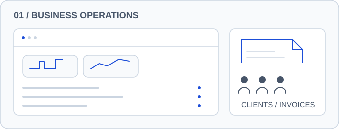
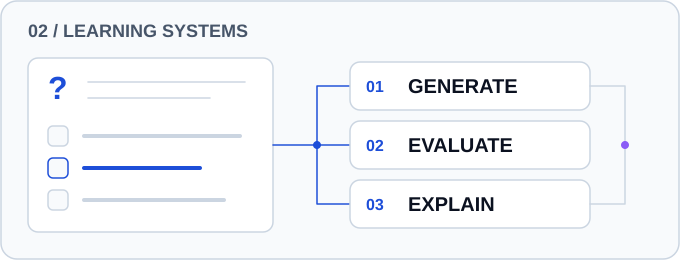
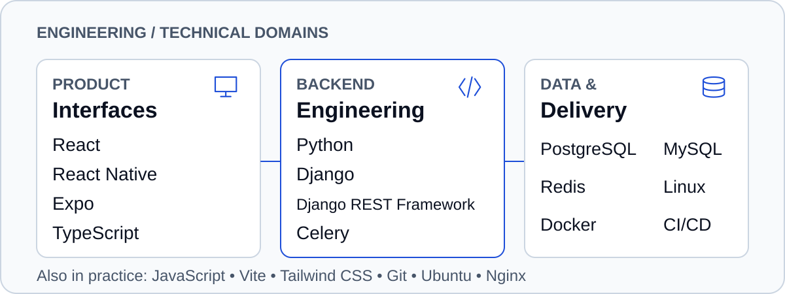
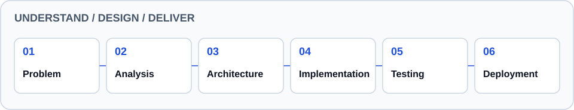

<picture>
  <source media="(max-width: 760px)" srcset="assets/branding/banner-mobile.svg">
  
</picture>

## About Me

I'm **Rochinel Lontchi**, a software developer based in Cameroon.
I build business applications that turn operational needs into useful products.
My work spans backend systems, web interfaces and mobile experiences.
I'm growing toward software architecture and infrastructure, with an entrepreneurial interest in products that serve real businesses.

## Featured Projects

<a href="https://github.com/Rochinel-codeur/Facteo">
  <picture>
    <source media="(max-width: 760px) and (prefers-color-scheme: dark)" srcset="assets/projects/facteo-mobile-dark.svg">
    <source media="(max-width: 760px)" srcset="assets/projects/facteo-mobile-light.svg">
    <source media="(prefers-color-scheme: dark)" srcset="assets/projects/facteo-dark.svg">
    
  </picture>
</a>

**[Facteo →](https://github.com/Rochinel-codeur/Facteo)** — Business invoicing with server-calculated totals, yearly numbering and document exports. [Architecture notes](https://github.com/Rochinel-codeur/Facteo/blob/main/docs/ARCHITECTURE.md).

<a href="https://github.com/Rochinel-codeur/QuizLy">
  <picture>
    <source media="(max-width: 760px) and (prefers-color-scheme: dark)" srcset="assets/projects/quizly-mobile-dark.svg">
    <source media="(max-width: 760px)" srcset="assets/projects/quizly-mobile-light.svg">
    <source media="(prefers-color-scheme: dark)" srcset="assets/projects/quizly-dark.svg">
    
  </picture>
</a>

**[QuizLy →](https://github.com/Rochinel-codeur/QuizLy)** — An experimental science quiz connecting AI-generated questions with evaluation and explanations.

Concept illustrations of public projects. Live deployments and production readiness remain unverified.

## Engineering Stack

<picture>
  <source media="(max-width: 760px) and (prefers-color-scheme: dark)" srcset="assets/branding/stack-mobile-dark.svg">
  <source media="(max-width: 760px)" srcset="assets/branding/stack-mobile-light.svg">
  <source media="(prefers-color-scheme: dark)" srcset="assets/branding/stack-dark.svg">
  
</picture>

Backend is my main practice; I'm deepening software architecture, UML, Docker & CI/CD, cloud infrastructure, distributed systems and AI integration.

## Engineering Approach

<picture>
  <source media="(max-width: 760px) and (prefers-color-scheme: dark)" srcset="assets/branding/approach-mobile-dark.svg">
  <source media="(max-width: 760px)" srcset="assets/branding/approach-mobile-light.svg">
  <source media="(prefers-color-scheme: dark)" srcset="assets/branding/approach-dark.svg">
  
</picture>

## GitHub Activity

<a href="assets/generated/activity.md">
  <picture>
    <source media="(max-width: 760px) and (prefers-color-scheme: dark)" srcset="assets/generated/activity-mobile-dark.svg">
    <source media="(max-width: 760px)" srcset="assets/generated/activity-mobile-light.svg">
    <source media="(prefers-color-scheme: dark)" srcset="assets/generated/activity-dark.svg">
    
  </picture>
</a>

[Snapshot & definitions](assets/generated/activity.md) · [All repositories](https://github.com/Rochinel-codeur?tab=repositories)

<picture>
  <source media="(prefers-reduced-motion: reduce) and (prefers-color-scheme: dark)" srcset="assets/generated/contributions-dark.svg">
  <source media="(prefers-reduced-motion: reduce)" srcset="assets/generated/contributions-light.svg">
  <source media="(prefers-color-scheme: dark)" srcset="assets/generated/snake-dark.svg">
  
</picture>

Daily refresh · Last successful images retained · Static calendar available with reduced motion.

## Connect

**Have an idea worth building?** 
Let's talk about the problem and build something useful.

[Email](mailto:lontchirochinel@gmail.com) · [GitHub](https://github.com/Rochinel-codeur)
